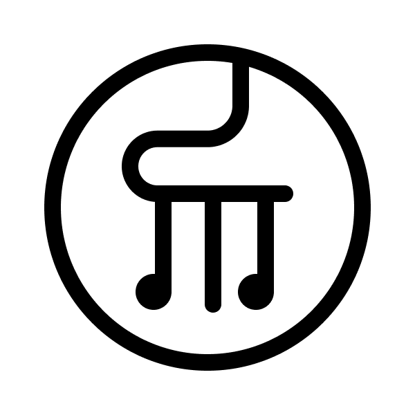

> 寻找初代 YuE？其代码、文档与许可证完整保留在 **[YuE-v1 分支](https://github.com/multimodal-art-projection/YuE/tree/YuE-v1)**。

> [!IMPORTANT]
> 本仓库是 [multimodal-art-projection/YuE](https://github.com/multimodal-art-projection/YuE) 的**非官方中文汉化版**，仅翻译文档（README 与 `docs/`、`examples/` 说明），代码、技能包与 PDF 报告保持英文原文。内容以上游仓库为准，汉化时间：2026 年 10 月。英文原版见 [README_EN.md](README_EN.md)。

<p align="center">
  
</p>

<p align="center">
  <picture>
    <source media="(max-width: 600px)" srcset="assets/institutions-mobile.svg" />
    
  </picture>
</p>

<h1 align="center">YuE2：以前沿质量统一符号与音频的音乐生成</h1>

<p align="center"><strong>以符号作曲，以声音创作。</strong></p>

<p align="center">
  <a href="https://arxiv.org/abs/2609.33757">📄 arXiv</a> ·
  <a href="docs/technical_report.pdf">PDF</a> ·
  <a href="https://map-yue2.github.io/">🎧 试听 Demo</a> ·
  <a href="https://yue.noizai.net/">🚀 免费在线体验</a> ·
  <a href="https://arena.3-148-255-99.sslip.io:8080">🗳️ 音乐竞技场</a> ·
  <a href="#动态">📰 动态</a> ·
  <a href="#快速开始">🚀 快速开始</a> ·
  <a href="#智能体技能">🤖 智能体技能</a> ·
  <a href="#基准测试">📊 基准测试</a> ·
  <a href="https://huggingface.co/m-a-p/YuE2-3B">🤗 YuE2</a> ·
  <a href="https://huggingface.co/m-a-p/MERT-v2-FullSong">🤗 MERT2</a> ·
  <a href="https://huggingface.co/m-a-p/SheetSage2">🤗 SheetSage2</a> ·
  <a href="https://huggingface.co/datasets/m-a-p/WildSongBench">🤗 WSB</a> ·
  <a href="https://github.com/multimodal-art-projection/YuE/releases/tag/yue2-v0.1.6">📦 Release</a> ·
  <a href="https://discord.gg/ssAyWMnMzu"></a>
</p>

<p align="center">
  <a href="https://trendshift.io/repositories/32209">
    
  </a>
  <br />
  <sub>全语言榜 · 2026 年 9 月 14 日</sub>
</p>

<p align="center">
  <a href="https://web.archive.org/web/20260917003427/https://huggingface.co/models?sort=trending">
    
  </a>
  <a href="https://huggingface.co/models?pipeline_tag=text-to-audio&amp;sort=trending">
    
  </a>
  <br />
  <sub>全站榜：2026 年 9 月 17 日 · 文生音频榜：2026 年 9 月 20 日</sub>
</p>

**YuE2 为音乐生成带来可编辑作曲的前沿歌曲质量。** 只需给出歌词和风格提示：它先写出一段可编辑的旋律-和弦规划，再把这份规划实现为一首带人声与伴奏的完整歌曲。

<a id="music-arena"></a>

> **🎧 YuE2 需要你的耳朵**
>
> 我们正在开展一项公开盲听测评，将 YuE2 与领先的商业音乐生成系统进行对比。收听匿名片段并选择 A、B 或持平。
>
> **[收听并投票 →](https://arena.3-148-255-99.sslip.io:8080)** · 无需注册，建议佩戴耳机。

- **前沿质量。** 在 WildSongBench 上，YuE2 与 Suno v5/v6 具有竞争力。YuE2（8 选 1）取得 **6.9632 的 SongBench 均分**，为所有参评设定中的最高均值。
- **通过符号规划实现白盒音乐生成。** 在渲染之前即可阅读、演奏并修改作曲。旋律与和弦成为显式的控制项，人和智能体都可以检查和编辑。
- **零样本翻唱与智能体编辑。** 把一段转写出的歌曲用新风格重新演绎，或围绕乐谱、编曲与歌词对话式地打磨一首歌——全部使用同一个生成权重。

[](https://map-yue2.github.io/#model-overview)

*192 条 WildSongBench 提示。两种 YuE2 设定均使用符号规划。Bo8 = 8 选 1。坐标轴为归一化对比指数，气泡面积代表 AudioBox 制作质量分。[评分与评测协议](docs/benchmarks.md)。[矢量 PDF](assets/frontier-teaser.pdf) · [SVG](assets/frontier-teaser.svg)。*

## 动态

- **📄 2026 年 10 月 6 日 — SheetSage2 登上 arXiv。** 阅读[论文](https://arxiv.org/abs/2610.05336)并查看 [BibTeX 引用](#引用)。

- **📄 2026 年 10 月 2 日 — SheetSage2 技术报告。** [SheetSage2 报告](docs/sheetsage2_technical_report.pdf)介绍了用于翻唱与乐谱编辑的转写模型：源自 MIDI 的合成监督、结构化解码与自回归蒸馏，并在八个基准集合上给出评测。

- **📄 2026 年 9 月 29 日 — YuE2 登上 arXiv。** 阅读[论文](https://arxiv.org/abs/2609.33757)并查看 [BibTeX 引用](#引用)。

- **📄 2026 年 9 月 26 日 — YuE2 技术报告。** [技术报告](https://arxiv.org/abs/2609.33757)现已发布，涵盖完整的模型与训练方法、自动评测与专家听测结果，以及乐谱编辑与零样本翻唱的评估。

- **🎹 2026 年 9 月 25 日 — 器乐生成与翻唱。** [yue2-music 智能体技能](#智能体技能)现在可以把一句简单描述、一份 ABC 乐谱或一段参考录音变成纯器乐音乐。YuE2 默认先写出乐谱；技能会把人声旋律移入器乐声部再渲染。**推荐智能体：GPT-6 Astra。**[下载更新版技能 →](https://github.com/multimodal-art-projection/YuE/releases/download/yue2-music-v1.2.0/yue2-music.zip)

- **🚀 免费在线体验 YuE2。** 在浏览器里直接创作歌曲：[NOIZ 托管的在线 Demo →](https://yue.noizai.net/)。无需安装。

- **⚡ YuE2-Turbo。** [NOIZ 的推理与服务工具包 →](https://github.com/NoizAI/YuE2-Turbo)可加速 YuE2 并支持并发请求。

- **🎛️ ComfyUI。** YuE2 已有原生节点与[官方文生音乐工作流 →](https://github.com/Comfy-Org/workflow_templates/blob/main/templates/audio_yue2_text2music.json)。

- **🎬 Maestro。** [Maestro →](https://github.com/Blizaine/Maestro) 集成了 YuE2，支持本地歌曲生成、作曲规划与翻唱。[作者推文 →](https://x.com/blizaine/status/2101852048538968458)

## 听听你能创作什么

| 创作 | 翻唱 | 智能体编辑 |
|---|---|---|
| 歌词 + 风格 → 乐谱 → 完整歌曲 | 原始录音 → 旋律乐谱 → 全新演绎 | 音乐反馈 → 乐谱、风格或歌词修改 → 新的录音 |
| [收听并查看乐谱](https://map-yue2.github.io/#abc-cot-gen) | [收听零样本翻唱](https://map-yue2.github.io/#cover) | [查看一段编辑对话](https://map-yue2.github.io/#agentic-music-editing) |

智能体演示曲目 **《The Last Train》历经 9 个步骤、14 个版本**，从普通话流行变成英语爵士，并加入新的和声与萨克斯独奏。可以逐版本收听，并查看对应的对话、乐谱、提示与歌词。

## 工作原理


一个 **AR–NAR 混合 Transformer（Mixture-of-Transformers）** 骨干网络自回归地预测乐谱与语义 token，再用流匹配生成声学潜变量，最后由 VAE 解码为立体声音频。创作、翻唱与编辑的区别只在乐谱来源：由 YuE2 生成、由录音转写，或来自一份编辑过的作曲。

分阶段的 Python API 依次为 `plan()` → `generate_semantic()` → `synthesize()` → `decode()`。精确复用规划与解码器选择见[生成指南](docs/generation.md)。

## 快速开始

**Linux · Python 3.12 · 支持 BF16、显存 24 GB 的 NVIDIA GPU。** YuE2 无需量化即可输出 48 kHz 立体声音频。模型文件会在首次使用时从 Hugging Face 自动下载。

```bash
git clone https://github.com/multimodal-art-projection/YuE.git
cd YuE
python3.12 -m venv .venv
source .venv/bin/activate
python -m pip install --upgrade pip
python -m pip install .
python examples/generate.py --output outputs/first-song
```

打开 `outputs/first-song/audio.flac` 即可试听。输出目录还会保留乐谱、语义 token、声学潜变量、生成设置与模型标识。

Python 接口同样简短：

```python
import json
from pathlib import Path
from yue2 import YuE2Pipeline

request = json.loads(Path("examples/song.json").read_text(encoding="utf-8"))
with YuE2Pipeline.from_pretrained("m-a-p/YuE2-3B", device="cuda") as pipe:
    song = pipe(**request)
    song.save_artifacts("outputs/my-song")
    print(song.truncated)
```

| 设定 | 行为 |
|---|---|
| `cot="full"` | 生成可编辑的旋律-和弦规划；新歌创作默认值 |
| `cot="melody"` | 只规划旋律，伴奏自由发挥；翻唱推荐 |
| `cot="off"` | 不使用符号规划，直接由歌词和风格生成 |
| `abc=...` | 在 `full` 或 `melody` 模式下传入你自己的乐谱 |

[生成指南](docs/generation.md) · [原始示例输入](examples/README.md) · [v0.1.6 wheel 归档](https://github.com/multimodal-art-projection/YuE/releases/download/yue2-v0.1.6/yue2_infer-0.1.6-py3-none-any.whl)

## 翻唱一首歌

先用 **[🤗 SheetSage2](https://huggingface.co/m-a-p/SheetSage2)** 转写原始录音，核对旋律，再提供新的歌词或目标风格。翻唱时请使用 **`cot="melody"` 并提供不带和弦符号的乐谱**，让伴奏可以适配新风格。

```python
from pathlib import Path
from yue2 import YuE2Pipeline

with YuE2Pipeline.from_pretrained("m-a-p/YuE2-3B", device="cuda") as pipe:
    cover = pipe(
        style="English, jazz-funk, warm lead vocal, Rhodes, bass and drums",
        lyrics=Path("cover-lyrics.txt").read_text(encoding="utf-8"),
        abc=Path("cover-score/score.abc").read_text(encoding="utf-8"),
        cot="melody",
        seed=42,
    )
    cover.save_artifacts("outputs/cover")
```

SheetSage2 运行在独立环境中，会自动加载它的 MERT2 编码器。[翻唱指南](docs/covers.md)给出完整的转写与生成命令。仓库还附带一份[原创旋律示例](examples/melody.abc)，让你立刻体验按乐谱条件生成。

## 编辑乐曲

先导出规划，修改音乐细节，再渲染编辑后的乐谱：

```python
import json
from pathlib import Path
from yue2 import YuE2Pipeline

request = json.loads(Path("examples/song.json").read_text(encoding="utf-8"))
with YuE2Pipeline.from_pretrained("m-a-p/YuE2-3B", device="cuda") as pipe:
    plan = pipe.plan(**request)
    plan.save("outputs/plan")
```

把 `outputs/plan/score.abc` 复制为 `edited.abc`，然后让智能体修改和声、旋律、速度或曲式。把编辑后的文件作为新乐谱传入：

```bash
python examples/generate.py --request examples/song.json \
  --abc-file edited.abc --cot full --output outputs/edited
```

可编辑乐谱就是白盒接口：你可以检查预期的作曲并介入其中。编辑会重新生成一段完整录音；编辑点之外的原始波形不会被保留。[编辑指南与可复现的和声示例](docs/editing.md)。

## 智能体技能

**[yue2-music 技能](skills/yue2-music/SKILL.md)** 教会智能体如何生成歌曲与器乐、转写并翻唱录音、编辑 ABC 乐谱、校验音乐不变量、组织听测对比。**我们推荐使用 GPT-6 Astra 作为智能体。** YuE2 仍是负责默认乐谱创作与音频生成的模型。

直接使用**本仓库的 `skills/yue2-music/`**，或下载 **[更新版技能 ZIP](https://github.com/multimodal-art-projection/YuE/releases/download/yue2-music-v1.2.0/yue2-music.zip)**，按你智能体的技能目录或导入机制安装。歌曲工作流使用 `pip install .` 安装的 Python 运行时；[器乐工作流](skills/yue2-music/instrumental/SKILL.md)自带固定的安装配方供智能体执行。更早的 v0.1.6 版本保持不变。

生成器乐音乐时，给智能体一句简单请求：

> 使用 yue2-music 技能，生成适合阅读的轻柔钢琴纯音乐，不要人声。给我可播放的音频和完整提示词。

翻唱成器乐时，附上一段参考录音或 ABC 乐谱：

> 把这段旋律改成木吉他器乐版。保留旋律，给我音频和完整提示词。

默认流程是 **YuE2 乐谱 → 把 Vocal 声部音符移入 Ins → 渲染**。音频翻唱会先用 SheetSage2 转写参考音频。只有明确要求时智能体才会另写新乐谱。辅助脚本会在转换后的乐谱中保留人声音符的音高、起音与时长，并记录重叠声部；仍需试听来检查人声串音与旋律保真度。

来试一个具体请求：

> 使用 yue2-music 技能创作一首英语钢琴流行歌。保留原始音频与乐谱。再做一版爵士和声的，保留人声旋律与歌词顺序，给我两版对比。

## 基准测试

**WildSongBench：192 条提示，自动评测，2026 年 9 月 12 日。**

| 系统 / 设定 | SongBench 均分 ↑ | AudioBox PQ ↑ | MuLan ↑ | PER ↓ |
|---|---:|---:|---:|---:|
| **YuE2（8 选 1）** † | **6.9632** | 8.2714 | 0.5051 | 9.79% |
| Mureka 9 | 6.9377 | 8.0226 | 0.4394 | 11.69% |
| Suno v5 | 6.8721 | 8.1698 | **0.5428** | 8.10% |
| **YuE2** † | 6.7316 | 8.2598 | 0.5068 | 8.44% |
| Suno v5.5 | 6.7150 | 8.1955 | 0.5089 | 5.96% |
| Suno v4.5 | 6.6995 | 8.2541 | 0.5022 | **5.80%** |
| Suno v6 | 6.5562 | 8.1296 | 0.4916 | 7.58% |
| Suno v6 Wild | 6.4195 | 8.1785 | 0.4999 | 7.45% |
| LeVo 2 † | 6.3247 | **8.3966** | 0.3542 | 26.12% |
| MiniMax Music 2.6 | 6.3222 | 8.1711 | 0.4251 | 24.55% |
| MiniMax Music 3 † | 6.2830 | 8.2825 | 0.3928 | 6.27% |
| HeartMuLa † | 6.2483 | 8.2933 | 0.3823 | 10.71% |
| Muse † | 6.0349 | 8.0517 | 0.3937 | 33.42% |
| ACE-Step 1.5 † | 6.0118 | 8.0518 | 0.4372 | 7.46% |
| DiffRhythm 2 † | 5.2428 | 7.9782 | 0.3782 | 18.41% |
| YuE 1 † | 4.9165 | 7.8683 | 0.2623 | 36.38% |
| SongBloom † | 4.2350 | 8.1539 | 0.2697 | 19.19% |

† 公开模型权重。表中列出全部 17 个参评设定，按 SongBench 均分排序；加粗值为各列最优。

两种 YuE2 设定均使用符号规划与基准解码器 **YuE2-Vae-legacy**。标准 YuE2 从两个候选中挑选，8 选 1 则从八个候选中挑选。各指标排名不一；最高均值之间差距很小，不构成统计显著性结论。[完整结果与挑选协议](docs/benchmarks.md)。

**零样本翻唱。** 在 948 首作品上，全乐谱 YuE2 取得 **0.647 的 CLEWS mAP**，而无乐谱时仅为 **0.006**——且使用的是未经翻唱微调的通用生成权重。来源身份保留与目标风格质量分别计量；仅旋律的翻唱在改编编曲上有更大自由度。[翻唱评测](docs/benchmarks.md#零样本翻唱生成)。

### 复现基准测试

如需复现报告中的基准分数，请按 [🤗 WildSongBench（WSB）](https://huggingface.co/datasets/m-a-p/WildSongBench#reproduce-standard-yue2)上的说明操作。

## MERT2

**最先进的音乐理解：** MERT2-30s 在 **15 项 MARBLE 指标中的 14 项**上领先，MERT2-FS（整曲）在 **15 项中的 13 项**上领先（对比所列外部基线）。MERT2-30s 在 GTZAN 上达到 **91.72% 的流派准确率**。

[Demo 与结果](https://map-yue2.github.io/#mert2) · [🤗 MERT2-30s](https://huggingface.co/m-a-p/MERT-v2-30s) · [🤗 MERT2-FS](https://huggingface.co/m-a-p/MERT-v2-FullSong)

## SheetSage2

**最先进的音频转乐谱：** 在报告的对比中，SheetSage2-AR 在 **15 项基准指标中的 12 项**上领先，包括 JAAH 和弦识别与 Rock Corpus 人声旋律转写。人声旋律音高类 F1 在 RWC-Pop 上为 **82.51%**，在 Rock Corpus 上为 **67.08%**。

[📄 arXiv](https://arxiv.org/abs/2610.05336) · [PDF](docs/sheetsage2_technical_report.pdf) · [Demo 与结果](https://map-yue2.github.io/#sheetsage2) · [🤗 模型与推理](https://huggingface.co/m-a-p/SheetSage2)

## 模型与资源

| 资源 | 用途 |
|---|---|
| [📄 YuE2 技术报告](https://arxiv.org/abs/2609.33757) | 模型、训练与评测细节 |
| [📄 SheetSage2 论文](https://arxiv.org/abs/2610.05336) | 转写方法、训练与评测细节 |
| [🤗 YuE2-3B](https://huggingface.co/m-a-p/YuE2-3B) | 歌曲生成、符号规划、翻唱与编辑 |
| [🤗 YuE2-Vae](https://huggingface.co/m-a-p/YuE2-Vae) | 默认的生成与试听解码器 |
| [🤗 YuE2-Vae-legacy](https://huggingface.co/m-a-p/YuE2-Vae-legacy) | 复现基准协议所用解码器 |
| [🤗 SheetSage2](https://huggingface.co/m-a-p/SheetSage2) | 服务于翻唱与编辑的音频转乐谱 |
| [🤗 MERT-v2-FullSong](https://huggingface.co/m-a-p/MERT-v2-FullSong) | 整曲音乐表征；SheetSage2 的编码器 |
| [🤗 MERT-v2-30s](https://huggingface.co/m-a-p/MERT-v2-30s) | 短录音的音乐表征 |
| [🤗 WildSongBench](https://huggingface.co/datasets/m-a-p/WildSongBench) | 评测提示与基准资源 |

生成并不强制要求 MERT2 特征提取：YuE2 的流水线不需要单独下载 MERT2 模型。[Demo 与交互式结果](https://map-yue2.github.io/) · [Release 下载](https://github.com/multimodal-art-projection/YuE/releases/tag/yue2-v0.1.6)。

## 许可证

| 使用场景 | 条款 |
| --- | --- |
| **个人用户、内容创作者与音乐人** | 可自由使用 YuE2 并对生成作品进行商业化，**无需向我们支付任何费用或版税**。 |
| **学术研究与教育** | **非商业用途**免费。 |
| **企业商业使用** | 请[联系我们](#联系)洽谈模型权重的商业许可。 |

我们强烈鼓励在分享生成作品时标注 **YuE2** 或带上 **#YuE2** 话题；署名是自愿的，并非强制。

**负责任的使用。** 附加创作者许可条款禁止违法、有害、欺骗性或不道德的使用。YuE2 按**现状提供，不附带任何保证**。用户需对自己的输入、输出与用途负责；责任限制见[完整条款](MODEL_LICENSE)。

**代码、智能体技能与文档：** [Apache 2.0](LICENSE)。**模型权重：** [CC BY-NC 4.0（附附加创作者许可条款）](MODEL_LICENSE)。

*版权所有 (c) 2026 YuE2 作者。[第三方组件](THIRD_PARTY_NOTICES.md)与更早版本沿用其各自许可证。*

## 引用

使用 YuE2、MERT2 或 WildSongBench 时，请引用 [YuE2 论文](https://arxiv.org/abs/2609.33757)：

```bibtex
@article{yuan2026yue2,
  title = {{YuE2}: Unifying Symbolic and Audio Music Generation at Frontier Quality},
  author = {Yuan, Ruibin and Pan, Jiahao and Jiang, Junyan and Wu, Zhiyue and Zhou, Ziya and Sun, Jiankai and Li, Yizhi and Zhang, Ge and Gu, Yicheng and Tian, Zeyue and Dai, Junyu and Lin, Hanfeng and Li, Kai and Wu, Shangda and Liu, Xuanjie and Wang, Jiaming and Liu, Zihan and Wang, Yue and Ma, Yinghao and Yin, Hanzhi and Chen, Kangrui and Zhang, Xinyue and Ma, Ziyang and Liao, Mengqi and Zhao, Hejia and Huang, Guowei and Yan, Chao and Ke, Lei and Yu, Jianwei and Liu, Bei and Guo, Joe and Xue, Liumeng and Xia, Gus and Xue, Wei and Guo, Yike},
  journal = {arXiv preprint arXiv:2609.33757},
  year = {2026},
  eprint = {2609.33757},
  archivePrefix = {arXiv},
  primaryClass = {eess.AS},
  url = {https://arxiv.org/abs/2609.33757}
}
```

使用 SheetSage2 时，请引用 [SheetSage2 论文](https://arxiv.org/abs/2610.05336)：

```bibtex
@misc{jiang2026sheetsage2,
  title = {{SheetSage2}: Coherent Lead-Sheet Transcription with Synthetic Supervision},
  author = {Jiang, Junyan and Yuan, Ruibin and Pan, Jiahao and Xue, Wei and Guo, Yike and Xia, Gus and LeCun, Yann},
  year = {2026},
  eprint = {2610.05336},
  archivePrefix = {arXiv},
  primaryClass = {cs.SD},
  url = {https://arxiv.org/abs/2610.05336}
}
```

如需引用初代 **[MERT](https://arxiv.org/abs/2306.00107)** 与 **[YuE](https://arxiv.org/abs/2503.08638)** 模型，请引用：

```bibtex
@article{li2023mert,
  title = {{MERT}: Acoustic Music Understanding Model with Large-Scale Self-supervised Training},
  author = {Li, Yizhi and Yuan, Ruibin and Zhang, Ge and Ma, Yinghao and Chen, Xingran and Yin, Hanzhi and Xiao, Chenghao and Lin, Chenghua and Ragni, Anton and Benetos, Emmanouil and Gyenge, Norbert and Dannenberg, Roger and Liu, Ruibo and Chen, Wenhu and Xia, Gus and Shi, Yemin and Huang, Wenhao and Wang, Zili and Guo, Yike and Fu, Jie},
  journal = {arXiv preprint arXiv:2306.00107},
  year = {2023},
  eprint = {2306.00107},
  url = {https://arxiv.org/abs/2306.00107}
}

@article{yuan2025yue,
  title = {{YuE}: Scaling Open Foundation Models for Long-Form Music Generation},
  author = {Yuan, Ruibin and Lin, Hanfeng and Guo, Shuyue and Zhang, Ge and Pan, Jiahao and Zang, Yongyi and Liu, Haohe and Liang, Yiming and Ma, Wenye and Du, Xingjian and Du, Xinrun and Ye, Zhen and Zheng, Tianyu and Jiang, Zhengxuan and Ma, Yinghao and Liu, Minghao and Tian, Zeyue and Zhou, Ziya and Xue, Liumeng and Qu, Xingwei and Li, Yizhi and Wu, Shangda and Shen, Tianhao and Ma, Ziyang and Zhan, Jun and Wang, Chunhui and Wang, Yatian and Chi, Xiaowei and Zhang, Xinyue and Yang, Zhenzhu and Wang, Xiangzhou and Liu, Shansong and Mei, Lingrui and Li, Peng and Wang, Junjie and Yu, Jianwei and Pang, Guojian and Li, Xu and Wang, Zihao and Zhou, Xiaohuan and Yu, Lijun and Benetos, Emmanouil and Chen, Yong and Lin, Chenghua and Chen, Xie and Xia, Gus and Zhang, Zhaoxiang and Zhang, Chao and Chen, Wenhu and Zhou, Xinyu and Qiu, Xipeng and Dannenberg, Roger and Liu, Jiaheng and Yang, Jian and Huang, Wenhao and Xue, Wei and Tan, Xu and Guo, Yike},
  journal = {arXiv preprint arXiv:2503.08638},
  year = {2025},
  eprint = {2503.08638},
  url = {https://arxiv.org/abs/2503.08638}
}
```

## 联系

<table>
  <tr>
    <td align="center" width="50%">
      <strong>&nbsp;微信</strong><br>
      <sub>中文用户</sub>
    </td>
    <td align="center" width="50%">
      <a href="https://discord.gg/ssAyWMnMzu"><strong>&nbsp;加入&nbsp;Discord</strong></a><br>
      <sub>全球用户</sub>
    </td>
  </tr>
  <tr>
    <td align="center" colspan="2">
      <details>
        <summary><strong>展开微信二维码</strong></summary>
        <br>
        <a href="assets/wechat-yue2-group.png">
          
        </a><br>
        <sub>点击放大<br>有效期至 2026 年 10 月 11 日</sub>
      </details>
    </td>
  </tr>
</table>

- **授权咨询：** [lauryliuyang@hkgai.org](mailto:lauryliuyang@hkgai.org)
- **数据合作：** [gezhang@umich.edu](mailto:gezhang@umich.edu)
- **学术合作：** [ryuanab@connect.ust.hk](mailto:ryuanab@connect.ust.hk)

---

*本中文文档由非官方汉化，如与[英文原版](README_EN.md)有出入，以上游为准。*
